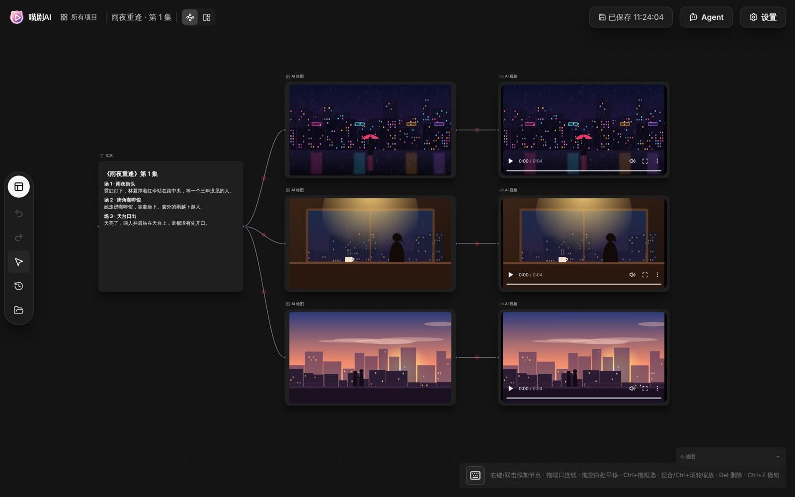
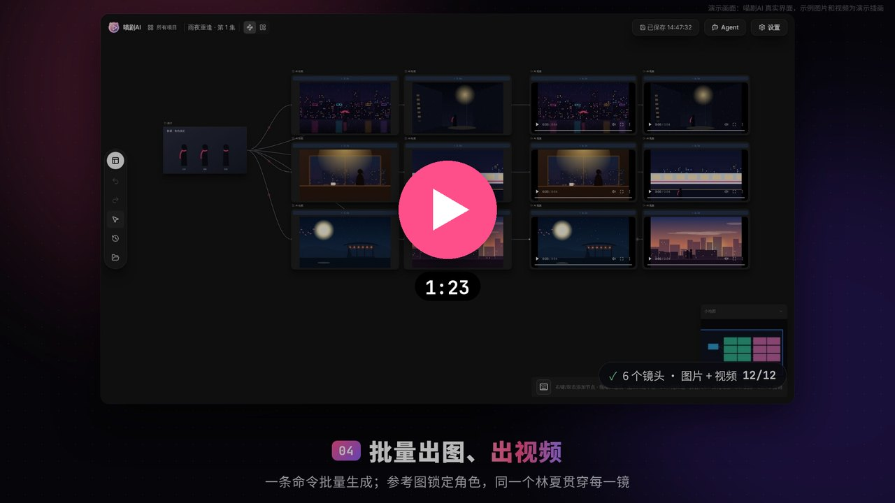
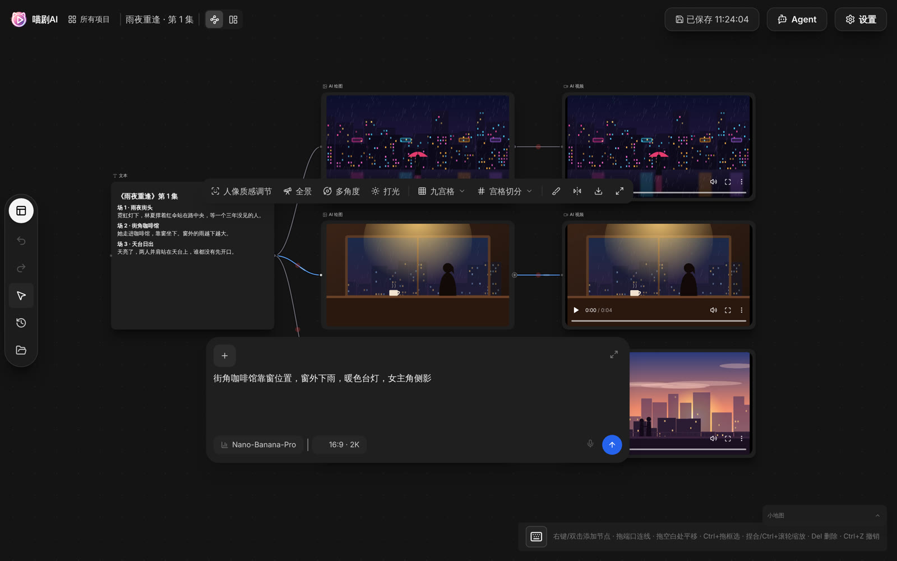
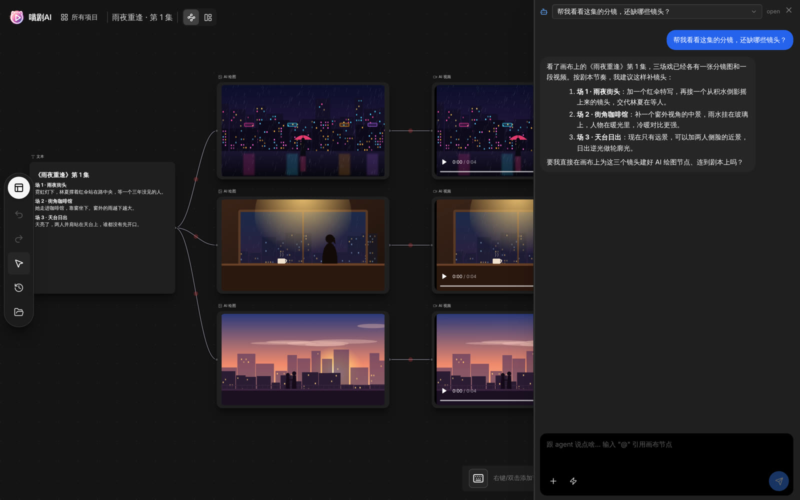
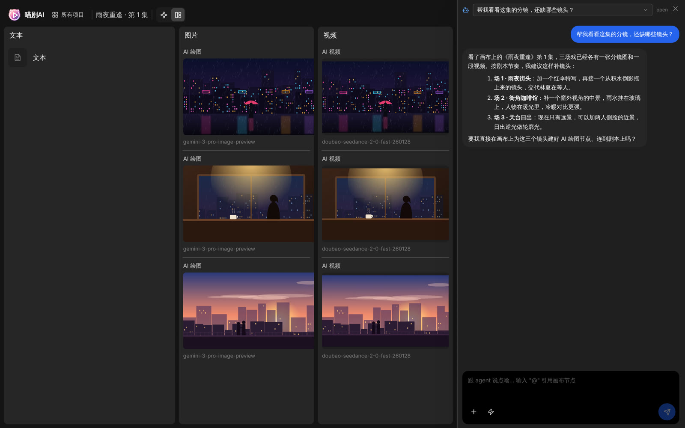
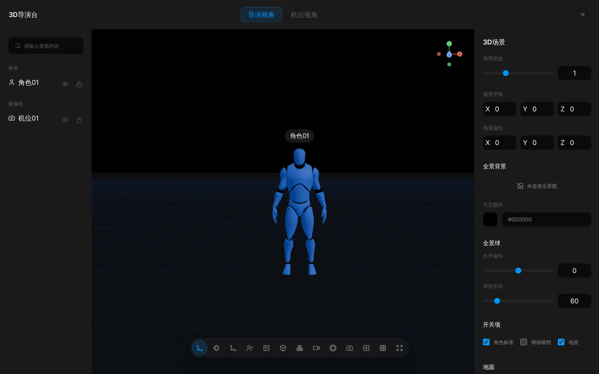

<p align="center">
  
</p>

<h1 align="center">Miaoju AI (喵剧AI)</h1>

<p align="center">
  <b>An open-source alternative to LibTV.</b> A local-first infinite canvas for AI short-drama production: chain scripts, images, video and voice into one workflow.
</p>

<p align="center">
  <a href="https://www.tvmao.net/"></a>
</p>

<p align="center">
  <a href="https://www.tvmao.net/">Try online</a> ·
  <a href="#promo-video">Promo video</a> ·
  <a href="#community">Community</a> ·
  <a href="README.md">中文</a> ·
  <a href="docs/user-guide.md">User guide (Chinese)</a> ·
  <a href="docs/development.md">Development (Chinese)</a>
</p>

<p align="center">
  
</p>

---

## Promo video

<a href="docs/media/promo.mp4"></a>

Hand Miaoju AI a script and it turns it into an episode of AI comic drama: the script is split into shots, the agent uses its director skill to build nodes on the canvas, Claude Code / Codex batch-generate images and video through the CLI, and you polish the result on the canvas. Click the cover to play (1:23, Chinese captions, no voiceover).

The video is a screen recording of the real Miaoju AI interface. Sample images and videos are illustrations drawn for the demo; the terminal segment re-enacts real `miaoju` commands and output.

## What it is

Miaoju AI is a desktop app for macOS and Windows. You place nodes on a canvas and connect them: uploaded images, videos, audio and text feed into AI image, video and audio generation nodes, and the results appear right on the canvas, ready to trim, crop, extend, upscale or pass to the next node.

- **Your data stays on your machine.** Projects, assets and generations live in a local data directory. No account, no cloud sync.
- **Bring your own models.** The app ships no model service. Point it at any gateway compatible with [New API](https://www.qqdao.com/), add your API key, and every built-in model works. Individual models can use their own upstream.
- **AI assistants can drive the canvas.** A built-in agent understands the canvas, runs skills and creates nodes for you. The bundled `miaoju` CLI lets Claude Code, Codex and other coding assistants operate the canvas from a terminal.

## How it compares to LibTV

Miaoju AI covers the same ground as LibTV and similar online AI video canvases: nodes and links on an infinite canvas that take you from script to storyboard frames, video and voice. The difference is that it is open source and runs on your own computer.

| | LibTV and similar online platforms | Miaoju AI |
|---|---|---|
| How it runs | Web service, account required | Desktop app, no account |
| Your assets | Stored in the platform's cloud | Stored only in a local data directory |
| Models and cost | The platform's models at the platform's prices | Your own New API compatible gateway, your own models and pricing |
| Source code | Closed | MIT licensed: change the code, add models, write skills |

Miaoju AI is an independent open-source project and is not affiliated with LibTV or its operator.

## Screenshots

| Image tools on the canvas | Built-in agent |
|---|---|
|  |  |
| **Storyboard view** | **3D director desk** |
|  |  |

The sample frames in the screenshots are illustrations drawn for the demo, not model output.

## Features

- Infinite canvas with undo/redo, minimap, auto-arrange and a storyboard view
- AI image, video and audio nodes; 20 built-in models including Nano-Banana, gpt-image-2, Seedream 5.0, Seedance 2.0 / 2.5, MiniMax-H3 and more
- Image tools: grid split, annotate, rotate/mirror, relight, multi-angle, panorama
- Video tools: trim, crop, extend, reshoot, upscale, subtitle removal, audio separation, frame extraction
- Script node that turns a screenplay or novel into shots and batch-generates video
- 3D director desk for blocking scenes and framing shots
- Generation history with ZIP export, asset library, and an AI character library (the character data pack is not included in the open-source build)
- `miaoju` command-line tool plus a skill for AI coding assistants

## Download

Get the latest build from [Releases](../../releases):

| OS | Package | Requirement |
|---|---|---|
| macOS (Apple silicon) | `喵剧AI_<version>_aarch64.dmg` | macOS 14+ |
| macOS (Intel) | `喵剧AI_<version>_x64.dmg` | macOS 14+ |
| Windows | `miaoju-windows-x64-<version>.zip` | Windows 10 / 11 x64 |

The builds are not code-signed, so the OS will block the first launch. On macOS, allow it under System Settings → Privacy & Security; on Windows, click "More info → Run anyway".

## Quick start

1. Open the app. It creates an untitled project and opens the canvas.
2. Open Settings → Model Center and enter your gateway URL (e.g. `https://example.com`, no `/v1`) and API key.
3. Right-click the canvas → Add node → AI Image, write a prompt and generate.
4. Connect the image to an AI Video node to animate it.

The UI is currently in Chinese.

## Architecture

| Directory | Stack | Role |
|---|---|---|
| `src-tauri/` | Rust, Tauri 2 | Desktop shell: launches and supervises the sidecar, data-dir migration, native save dialogs, CLI install |
| `web/` | React 18, TypeScript, Vite, Ant Design | Canvas editor, nodes, agent panel, settings |
| `server/` | Go, SQLite, Eino | Local sidecar on `127.0.0.1`: REST + WebSocket API, generation queue, media storage, agent, skill runtime |
| `cli/` | Go | `miaoju` CLI talking to the running sidecar |

## Building from source

Requires Node.js 22, pnpm 10, Go 1.26, Rust stable and `tauri-cli` 2.12+. Development and packaging run on macOS; the Windows build is cross-compiled.

```sh
pnpm install
pnpm dev
pnpm test:server && pnpm test:web && pnpm test:tauri && pnpm test:scripts
```

See [docs/development.md](docs/development.md) for details.

## Community

Questions, tips or want to help build it? Scan the QR code with WeChat to join the 喵剧AI open-source group (Chinese):

<p align="center">
  
</p>

## Contributing

Issues and pull requests are welcome; see [CONTRIBUTING.md](CONTRIBUTING.md). Please report security issues privately as described in [SECURITY.md](SECURITY.md).

## License

[MIT](LICENSE). Bundled third-party assets (such as the 3D mannequin model) keep their own licenses; see the license files next to them.

## Disclaimer

Miaoju AI is a creative tool and does not provide any model service. When generating content with third-party models, follow their terms of service and your local laws, and do not create content that infringes on others' likeness, copyright or other rights.
