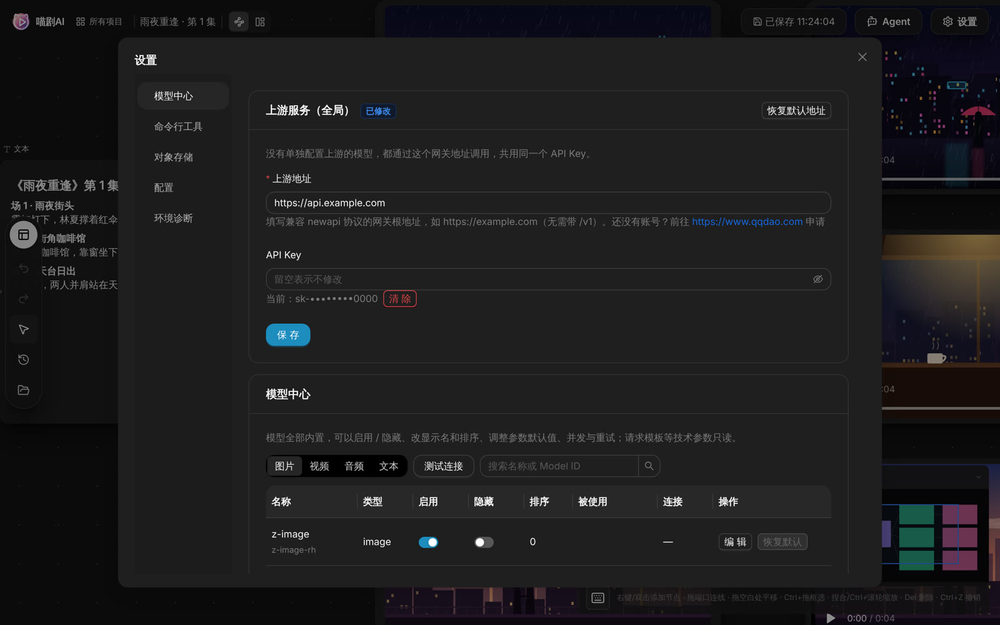

# 🎬 喵剧AI 使用指南

> 🔥 **下载安装**：[GitHub Releases](../../../releases)（macOS / Windows）　**线上体验**：[www.tvmao.net](https://www.tvmao.net/)
>
> 🤖 **命令行工具 / AI 编程助手接入**：[CLI 接入 Claude Code / Codex](ai-coding-tools.md)　**命令手册**：[CLI 手册](../cli/skill/SKILL.md)
>
> 💬 **问题反馈 / 功能建议**：[GitHub Issues](../../../issues)，或扫码加入 [微信交流群](../README.md#交流群)

> 📅 **更新记录**：每个版本的新功能和修复见 [Releases](../../../releases) 页面。

## 📢 更新公告

**2026-10-17 · v1.0.0 首个开源版本**

- 🆕 无限画布：AI 绘图、AI 视频、AI 音频、文字、脚本、3D 导演台、保存到本地等节点，连线即工作流。
- 🆕 图像工具：绘图预设（故事板、角色三视图、多机位九宫格等 14 种）、多角度、打光、宫格切分、标注、旋转与镜像。
- 🆕 视频工具：剪辑、裁剪、片段重拍、智能续写、高清、白模、智能去字幕、音频分离。
- 🆕 脚本节点：剧本拆分镜 → 准备资产 → 批量创建视频节点。
- 🆕 Agent 与技能：导演、编剧、复刻视频等内置技能。
- 🆕 命令行工具 `miaoju`：让 Claude Code、Codex 直接操作画布。

## 欢迎使用喵剧AI

喵剧AI 是一个开源、本地优先的 AI 短剧创作画布，运行在 macOS 和 Windows 上。在一张无限画布上放节点、拉连线：剧本、图片、视频、音频作为输入，接到 AI 绘图、AI 视频、AI 音频等生成节点，结果直接出现在画布上，可以继续剪辑、续写、超分，或者再接到下一个节点。

项目和素材都保存在你自己的电脑上，不需要注册账号；模型通过你自己的网关调用，费用由你掌握。

第一次使用，建议先跟着 [上手教程](tutorial.md) 做一遍，再回到这里按需查阅。

<p align="center"></p>

---

## 📖 指南目录

- [📢 更新公告](#-更新公告)
- [0. 开始之前](#0-开始之前)
  - [0.1 安装与首次打开](#01-安装与首次打开)
  - [0.2 接入模型](#02-接入模型)
- [1. 无限画布](#1-无限画布)
  - [1.1 新建项目](#11-新建项目)
  - [1.2 基础节点 🔥](#12-基础节点-)
  - [1.3 工作流搭建 🔥](#13-工作流搭建-)
  - [1.4 画布功能](#14-画布功能)
- [2. 画布实用工具](#2-画布实用工具)
  - [2.1 绘图预设 🔥](#21-绘图预设-)
  - [2.2 图像工具](#22-图像工具)
  - [2.3 视频工具](#23-视频工具)
  - [2.4 3D 导演台 💥](#24-3d-导演台-)
  - [2.5 音频工具](#25-音频工具)
- [3. 图像生成器](#3-图像生成器)
  - [3.1 文生图](#31-文生图)
  - [3.2 参考图生图 🔥](#32-参考图生图-)
  - [3.3 预设与镜头控制](#33-预设与镜头控制)
  - [3.4 多张生成与版本](#34-多张生成与版本)
- [4. 视频生成器](#4-视频生成器)
  - [4.1 文生视频](#41-文生视频)
  - [4.2 图生视频 🔥](#42-图生视频-)
  - [4.3 参考视频与参考音频](#43-参考视频与参考音频)
  - [4.4 虚拟人像 🆕](#44-虚拟人像-)
  - [4.5 高级编辑](#45-高级编辑)
- [5. 脚本节点：剧本到批量出片 🔥](#5-脚本节点剧本到批量出片-)
- [6. Agent 与技能](#6-agent-与技能)
- [7. 模型清单](#7-模型清单)
  - [7.1 图像模型](#71-图像模型)
  - [7.2 视频模型](#72-视频模型)
  - [7.3 语言大模型](#73-语言大模型)
  - [7.4 音频模型](#74-音频模型)
- [8. 快捷键操作](#8-快捷键操作)
- [9. 命令行工具与 AI 编程助手](#9-命令行工具与-ai-编程助手)
- [10. 设置](#10-设置)
- [11. 数据、备份与升级](#11-数据备份与升级)
- [常见问题](#常见问题)

---

## 0. 开始之前

### 0.1 安装与首次打开

从 [Releases](../../../releases) 下载对应系统的安装包。

**macOS**（要求 macOS 14 或更高版本）

1️⃣ Apple 芯片（M1 及以后）下载文件名带 `aarch64` 的 dmg，Intel 芯片下载带 `x64` 的。不确定的话点屏幕左上角苹果菜单 →「关于本机」查看。

2️⃣ 打开 dmg，把「喵剧AI」拖进「应用程序」。

3️⃣ 第一次打开会被系统拦截（应用没有购买苹果开发者证书）。打开「系统设置 → 隐私与安全性」，在最下方点「仍要打开」，输入开机密码确认。

4️⃣ 如果提示「已损坏，无法打开」，在「终端」里执行：

```sh
sudo xattr -dr com.apple.quarantine /Applications/喵剧AI.app
```

**Windows**（要求 Windows 10 / 11 64 位）

1️⃣ 下载 zip，右键「全部解压缩」，打开解压后的文件夹双击 `miaoju.exe`。不要在压缩包里直接运行，也不要只拷走 `miaoju.exe`，它依赖同目录下的 `sidecar.exe` 等文件。

2️⃣ 出现「Windows 已保护你的电脑」时，点「更多信息 → 仍要运行」。

3️⃣ 提示缺少 WebView2 时，点「确定」打开微软下载页安装。Windows 11 和较新的 Windows 10 已经自带。

4️⃣ 杀毒软件拦截 `sidecar.exe` 时请加入信任，它是喵剧AI 的本地服务，只监听本机 `127.0.0.1`。

### 0.2 接入模型

**功能**：喵剧AI 不自带模型服务，需要接入一个兼容 [New API](https://www.qqdao.com/) 协议的模型网关，所有内置模型都通过它调用。

<p align="center"></p>

1️⃣ 点画布右上角「设置」，进入「模型中心」。

2️⃣ 在「上游服务（全局）」里填写：
- **上游地址**：网关的根地址，例如 `https://example.com`。不用带 `/v1`，填了也会自动去掉。
- **API Key**：网关给你的密钥。

3️⃣ 点「保存」。所有没有单独配置上游的模型都会通过这个地址调用。可以点「测试连接」确认网关可用。

**给单个模型配置独立上游**：在模型列表里点某个模型的「编辑」，把「独立上游」从「使用全局」改成「单独配置」，填写该模型专用的上游地址和 API Key（两项必须同时填写）。适合某个模型只在另一家网关上有渠道的情况。

> ⚠️ 给模型单独配置上游后，引用「已通过 Seedance 合规校验」素材的生成可能失败，因为校验记录属于原来的网关。

> API Key 只保存在本机数据目录的 `data.db` 中，界面上只显示掩码，不会写入日志。

---

## 1. 无限画布

### 1.1 新建项目

**功能**：每个项目就是一张画布，画布内容随编辑自动保存，顶栏会显示「已保存 HH:MM:SS」。

- 启动时自动打开上一次的项目；没有的话打开最近修改的项目；一个项目都没有时自动新建「未命名项目」。
- 点画布左上角「所有项目」进入项目列表，点「开始创作 / 创建新的视频项目」新建项目。
- 项目卡片的菜单里可以：打开、重命名（名称和描述）、修改封面（从项目中选择或上传图片）、创建副本、删除项目。
- 在画布顶栏直接点击项目名也可以重命名。

### 1.2 基础节点 🔥

#### 1.2.1 新建节点

**功能**：把素材和生成能力放到画布上。添加节点有 5 种方式：

1️⃣ **双击画布空白处**：直接打开「添加节点」菜单。

2️⃣ **右键画布空白处**：选「添加节点」或「上传」。右键菜单里还有撤销、重做、粘贴。

3️⃣ **拖入文件**：把图片、视频、音频文件从系统直接拖进画布，会自动建成对应的节点并上传。

4️⃣ **粘贴**：⌘/Ctrl + V 粘贴复制的节点、图片或文字，文字会变成文字节点。

5️⃣ **从生成历史选择**：「添加节点」菜单最后一项，按 图片 / 视频 / 音频 筛选，一次最多选 10 个历史结果放到画布上。

「添加节点」菜单里的节点：

| 分组 | 节点 | 作用 |
|---|---|---|
| 生成 | AI 绘图 | 调用图片模型，见 [3. 图像生成器](#3-图像生成器) |
| 生成 | AI 视频 | 调用视频模型，见 [4. 视频生成器](#4-视频生成器) |
| 生成 | AI 音频 | 调用音频模型（配音、音效） |
| 生成 | 脚本 | 剧本拆分镜 → 批量生视频，见 [5. 脚本节点](#5-脚本节点剧本到批量出片-) |
| 生成 | 3D导演台 | 3D 摆位预演 → 机位截图，见 [2.4](#24-3d-导演台-) |
| 输入 | 上传 | 图片 / 音频 / 视频，按文件类型自动建成对应节点 |
| 输入 | 文字节点 | 写剧本、提示词，也能让大模型帮你写 |
| 输出 | 保存到本地 | 把连入的图片或视频下载到电脑 |

#### 1.2.2 文字节点 📝

**功能**：编写剧本、角色设定、提示词，内容可以连到下游节点作为文字输入。

- 编辑工具栏：标题 1/2/3、正文、粗体、斜体、无序列表、有序列表、分割线、复制内容、展开编辑。
- **AI 写作**：选中文字节点，下方会出现生成条。写下要求（如「写一段 300 字的雨夜重逢剧本」），选文本模型后生成。
- 连入图片后可以写「根据图片，帮我生成提示词」，让大模型看图写提示词。

#### 1.2.3 图片节点 🖼️

**功能**：承载、展示单张图片。图片有两种来源：

1️⃣ **上传**：拖入图片或右键「上传」，得到图片节点。点「更换」可以换图，双击查看大图。

2️⃣ **AI 绘图**：添加「AI 绘图」节点，写提示词生成，详见 [3. 图像生成器](#3-图像生成器)。

选中带图的节点，上方会出现图片工具条（人像质感调节、全景、多角度、打光、九宫格、宫格切分、标注、旋转与镜像、下载、放大查看），详见 [2.2 图像工具](#22-图像工具)。

#### 1.2.4 视频节点 🎥

**功能**：承载、播放视频。同样有两种来源：

1️⃣ **上传**：拖入 MP4 / WEBM 视频，得到视频节点。上传的视频节点还可以抽帧：
- 「自动抽帧（2fps）」或「智能抽帧」，抽出的帧显示在缩略图区；
- 勾选需要的帧，点「发送到画布」，每帧变成一个图片节点，可以拿去当参考图；
- 单帧可以删除、上移、下移，也可以「清空」重来。

2️⃣ **AI 视频**：添加「AI 视频」节点生成，详见 [4. 视频生成器](#4-视频生成器)。

选中视频节点，上方会出现视频工具条（剪辑、片段重拍、裁剪、高清、白模、智能续写、智能去字幕、音频分离），详见 [2.3 视频工具](#23-视频工具)。

#### 1.2.5 音频节点 🎵

**功能**：承载、播放音频，带波形预览。

1️⃣ **上传**：拖入音频文件，或点「点击选择音频」。

2️⃣ **AI 音频**：添加「AI 音频」节点，选模型、写内容生成。
- 「微软tts」：从 21 种内置音色里选，可以设置语速（0.5~2）、音调（-50~50）和说话风格（通用、开心、悲伤、友好、聊天）。
- 「豆包-音频生成-1.0」：可以连入一段音频作为**音色参考**，提示词里用 `@` 引用，生成的声音会贴近参考音色。微软tts 不读取连入的音频。

选中音频节点可以截取、变速，详见 [2.5 音频工具](#25-音频工具)。

#### 1.2.6 脚本节点 🎬

**功能**：把一段剧本或小说拆成分镜表，准备好角色和场景资产，再批量创建视频生成节点。完整流程见 [5. 脚本节点](#5-脚本节点剧本到批量出片-)。

#### 1.2.7 保存到本地

**功能**：把上游的图片或视频保存到电脑。连接上游节点后，可以单个「下载」，也可以「全部下载」。

#### 1.2.8 常用节点操作

**选中与移动**：点击选中，拖动移动；⌘/Ctrl + 左键拖动可以框选多个节点。

**重命名**：点击节点上方的名称即可修改。

**多次生成与版本**：一个生成节点可以多次生成，用「上一张 / 下一张 / 所有版本」翻看历史结果，不要的版本可以「删除该版本」。

**右键菜单**（图片、视频、音频类节点）：

| 菜单项 | 作用 |
|---|---|
| Seedance 合规校验 | 把素材提交校验，通过后才能用于 Seedance 2.0 生成，见 [7.2](#72-视频模型) |
| 发送到画布 | 把生成结果单独放成一个节点（AI 绘图 / 视频 / 音频节点） |
| 复制节点 ⌘C | 复制到画布剪贴板，可以粘贴到其他项目 |
| 创建副本 ⌘D | 连同上游连线一起复制一份 |
| 保存到素材库 | 选择文件夹并命名，以后在任何项目里都能用 |
| 在访达中显示 / 在资源管理器中显示 | 打开已保存到本地的文件所在位置 |
| 删除 | 删除节点及其连线 |

> 节点上出现「未保存到本地」角标时，说明生成结果还没下载到本机数据目录，点「重试」即可。

### 1.3 工作流搭建 🔥

#### 1.3.1 基础工作流示例

**功能**：从一个节点的输出端口拖线到另一个节点的输入端口，上游内容就成了下游生成的输入（参考图、首帧、参考视频、音色等）。

| 想做的事 | 节点怎么连 |
|---|---|
| 文生图 | AI 绘图 |
| 图生视频 | 图片 → AI 视频 |
| 角色一致的多个镜头 | 角色参考图 → 多个 AI 绘图 → 各自接 AI 视频 |
| 剧本批量出片 | 文字（剧本）→ 脚本节点 → 批量创建 AI 视频 |
| 构图预演 | 3D 导演台截图 → AI 绘图 / AI 视频 |
| 参考片取帧 | 上传视频 → 抽帧 → 发送到画布 → AI 绘图 / AI 视频 |
| 配音 | 文字 → AI 音频 |
| 导出 | 任意图片 / 视频 → 保存到本地 |

#### 1.3.2 工作流操作

- **连线**：从输出端口拖到输入端口；多张参考图的顺序就是连线的顺序。
- **自动整理**：选中两个以上节点，点左侧栏顶部的「自动整理」，节点会对齐排列、去掉堆叠。
- **跨项目复用**：选中节点 ⌘/Ctrl + C，切到其他项目 ⌘/Ctrl + V，连线会一起带过去。
- **创建副本**：⌘/Ctrl + D 复制一组节点，适合同一套参数改提示词出多个镜头。

#### 1.3.3 工作流 Showcase

下面四个案例覆盖了短剧创作最常见的流程，可以照着搭一遍。

**案例一：定妆 → 同一角色的多个镜头**

1️⃣ 上传角色照片（或用 AI 绘图生成一张）。

2️⃣ 选中图片 →「九宫格 ▾」→「角色三视图」，生成正面、侧面、背面全身设定图。

3️⃣ 新建几个 AI 绘图节点，都连上三视图，分别写「在雨夜巷口回头」「在咖啡馆靠窗看书」等镜头描述。

4️⃣ 每张满意的镜头图接一个 AI 视频节点，写动作和运镜，生成。

```text
角色照片 → [角色三视图] → AI 绘图 ×N → AI 视频 ×N
```

**案例二：剧本 → 整集分镜素材**

1️⃣ 文字节点写剧本，连到脚本节点，生成分镜脚本并确认。

2️⃣ 准备资产：角色用案例一的三视图，场景用「场景设定图」预设生成。

3️⃣ 批量生成视频，逐镜点生成；切到故事板视图按镜头顺序检查。

4️⃣ 不满意的镜头用「片段重拍」局部重做，太短的用「智能续写」，最后全部连到「保存到本地」导出。

```text
文字（剧本）→ 脚本 → 准备资产 → AI 视频组 → 故事板检查 → 保存到本地
```

**案例三：参考片 → 复刻镜头**

1️⃣ 上传一段参考视频。

2️⃣ 打开 Agent，选技能「一键复刻视频」，@ 这段视频，让它拆出可复用的分镜和提示词。

3️⃣ 也可以在视频节点上「智能抽帧」，把关键帧发送到画布，作为构图参考接到 AI 绘图或 AI 视频节点。

4️⃣ 需要沿用参考片的动作时，用「白模」得到白模视频，作为动作参考连进 AI 视频节点（需模型支持视频输入，见 [7.2](#72-视频模型)）。

```text
参考视频 → Agent「一键复刻视频」/ 抽帧 / 白模 → AI 视频
```

**案例四：场景全景 → 导演台定机位 → 出镜头**

1️⃣ 场景图 →「全景」，生成 720 全景图。

2️⃣ 新建 3D 导演台，「导入全景图」作为背景，摆好人偶和姿势，添加机位截图。

3️⃣ 截图发送到画布，和角色图一起连进 AI 绘图，生成构图准确的镜头图。

4️⃣ 镜头图接 AI 视频生成。

```text
场景图 → [720全景] → 3D 导演台截图 + 角色图 → AI 绘图 → AI 视频
```

### 1.4 画布功能

#### 1.4.1 顶栏

| 位置 | 作用 |
|---|---|
| 喵剧AI / 所有项目 | 回到项目列表 |
| 项目名 | 点击重命名 |
| 工作流 / 故事板 | 切换画布视图和故事板视图 |
| 已保存 | 显示最近一次自动保存时间 |
| Agent | 打开 Agent 对话面板，见 [6](#6-agent-与技能) |
| 设置 | 打开设置，见 [10](#10-设置) |

#### 1.4.2 画布左侧栏

从上到下依次是：自动整理、撤销、重做、选择、生成历史、素材库。

**生成历史**：按时间列出所有生成结果，可以搜索提示词或模型，按 全部 / 成功 / 失败 / 处理中 筛选；可以多选批量下载、删除；单条可以「发送到画布」、预览、下载、复制提示词。

**素材库**：用文件夹整理常用的角色图、场景图。「新建」里可以新建文件夹或上传资源；点条目上的「应用到画布」或直接拖进画布即可使用。

**虚拟人像库**：在素材库里打开，可以按职业、人设搜索，按性别、年龄段筛选，把角色形象「应用到画布」用于 Seedance 生成。开源版不附带角色数据，人像库默认为空；自行构建时放入数据包的方法见 [seed/README.md](../seed/README.md)。

#### 1.4.3 故事板视图

**功能**：按「文本 / 图片 / 视频 / 音频」分栏，把画布上的内容排成故事板，方便逐镜浏览和精修。

<p align="center"></p>

- 点顶栏的「故事板」进入，点「工作流」回到画布。
- 卡片会显示生成中、上传中、失败、待生成等状态。
- 点击卡片打开详情面板查看和调整；把其他图片或视频卡片拖进详情面板的参考区，会自动连线。
- 脚本、3D 导演台、保存到本地等节点不在故事板里显示。

#### 1.4.4 小地图导航

画布右下角的「小地图」显示整张画布的缩略图，点击或拖动可以快速定位，也可以折叠起来。

#### 1.4.5 @ 引用

在 AI 绘图、AI 视频、AI 音频的提示词里输入 `@`，可以引用已经连入的参考图、视频或音频，告诉模型每个素材的作用，例如「@图1 中的角色走进 @图2 的咖啡馆」。在 Agent 输入框里输入 `@` 则可以引用画布上的任意节点。

---

## 2. 画布实用工具

### 2.1 绘图预设 🔥

**功能**：一键套用常用的分镜、设定图提示词模板，不用自己写长提示词。

选中一张图片，点图片工具条上的「九宫格 ▾」，或者在 AI 绘图节点（模型为 gpt-image-2 时）点「预设」，可以选择：

| 分类 | 预设 |
|---|---|
| 分镜叙事 | 调度故事板、故事板、剧情推演四宫格、画面推演-3秒后、画面推演-5秒前 |
| 设定图 | 角色脸部三视图、角色设定图、角色三视图、场景设定图、产品设定图 |
| 空间与机位 | 720全景、多机位九宫格 |
| 质感调节 | 电影级光影校正、人像质感调节 |

从图片工具条选择预设时，会在右侧新建一个已连好原图、套好预设的 AI 绘图节点。**不会自动生成**，确认后点生成按钮。

每个预设能做什么：

| 预设 | 效果 | 需要原图 |
|---|---|---|
| 调度故事板 🔥 | 把 10–15 秒的小剧情整理成 4–6 格手绘调度分镜，标明景别、机位、运动方向和走位 | 可选 |
| 故事板 | 6 格连续分镜，按「建立 → 起因 → 运动 → 冲突 → 结果 → 暗示」推演 | 可选 |
| 剧情推演四宫格 | 4 格漫画分镜，从前置起因推演到 5 秒后的结果 | 可选 |
| 画面推演-3秒后 | 按物理规律推演 3 秒后的画面 | 必须 |
| 画面推演-5秒前 | 反推 5 秒前的画面 | 必须 |
| 角色脸部三视图 | 同一角色的三种表情特写，头部角度和五官保持一致 | 可选 |
| 角色设定图 | 完整设定稿：立绘、发型、表情、服装结构、材质、配色 | 可选 |
| 角色三视图 🔥 | 正面、侧面、背面全身，白底 | 可选 |
| 场景设定图 | 场景主视角、平面布局、局部结构、道具位置、光影方向 | 可选 |
| 产品设定图 | 产品多视图、局部放大、材质和功能分区 | 可选 |
| 720全景 | 把场景向四周补全成 720° 全景图，可导入 3D 导演台当背景 | 可选 |
| 多机位九宫格 🔥 | 同一场景 9 个机位：正面、侧面、背面、低机位、高机位、特写、中近景、广角、反打 | 必须 |
| 电影级光影校正 | 不改内容，只统一光源、曝光、色温和阴影层次 | 可选 |
| 人像质感调节 | 让人物和背景更融合，皮肤和纹理更真实，见 [2.2.1](#221-人像质感调节--全景-720) | 必须 |

> 💡 「可选」的预设不连图时就是文生图，直接把需求写进提示词即可；连了图会保持原图的角色、场景和画风。

### 2.2 图像工具

选中**一个**带图片的节点，上方会出现图片工具条。

<p align="center"></p>

#### 2.2.1 人像质感调节 / 全景 720°

新建一个套用「人像质感调节」或「720全景」预设的 AI 绘图节点，原图已经连好，点生成即可。

「人像质感调节」在 AI 绘图节点上还可以打开参数面板，每一项选一档：

| 参数 | 档位 |
|---|---|
| 人景融合 | 轻度对齐 / 自然融合 / 深度融合 |
| 光影融合 | 柔和补光 / 自然匹配 / 氛围强化 |
| 皮肤 | 清透修饰 / 自然肤质 / 真实肌理 |
| 纹理 | 柔和纹理 / 自然纹理 / 颗粒质感 |
| 锐度 | 柔焦 / 标准清晰 / 高清锐化 |

适合把 AI 生成的人物「去塑料感」，或者让抠图合成的人物和背景更自然。

#### 2.2.2 多角度

**功能**：基于原图生成换了机位的画面。

- 预设视角：自定义、鱼眼视角、倾斜视角、正面俯拍、正面仰拍、全景俯拍、背面视角。
- 手动调节：水平环绕、垂直俯仰、景别缩放（全景 / 中景 / 特写），也可以直接拖动球体。
- 可以补充提示词、选择绘图模型，点「↑」提交。

#### 2.2.3 打光

**功能**：给画面重新布光。

- 「透视 / 正面」两种视角调节光源。
- 全局亮度、颜色；主光源方向（左侧、顶部、右侧、前方、底部、后方）；轮廓光开关。
- 打开「智能模式」后可以写提示词、加参考图，或选择光影预设：过曝胶片、蓝色逆光、伦勃朗光、赛博朋克、落日迷幻、神秘暗调、黄金时刻、诺兰冷灰。

#### 2.2.4 九宫格

列出全部 [绘图预设](#21-绘图预设-)，「多机位九宫格」排在第一个。

#### 2.2.5 宫格切分

**功能**：把一张宫格图（比如九宫格分镜）切成单张图片。

1️⃣ 选择规格：4宫格（2×2）、9宫格（3×3）、16宫格（4×4）、25宫格（5×5）或自定义。

2️⃣ 在图上点选需要的格子。

3️⃣ 点「创建分镜组」，每一格变成一个新的图片节点。

#### 2.2.6 标注

用画笔、矩形、文字在图上做标记（可选颜色、线宽，可撤销重做），点「保存」生成一张新的标注图。适合标出要修改的位置，再交给模型重绘。

#### 2.2.7 旋转与镜像

输入角度（0–360），或一键顺时针旋转 90°、水平镜像、垂直镜像，点「保存」生成新图。

#### 2.2.8 下载 / 放大查看

下载当前图片，或打开大图查看。

### 2.3 视频工具

选中一个视频节点，上方会出现视频工具条。所有处理结果都生成为新节点，原视频不受影响。

| 工具 | 作用 | 是否调用模型 |
|---|---|---|
| 剪辑 | 截取一段时间，生成新视频节点 | 否，本机完成 |
| 裁剪 | 框选画面区域，按 Enter「生成裁剪」 | 否，本机完成 |
| 音频分离 | 拆出音轨和无声视频，各成一个节点 | 否，本机完成 |
| 片段重拍 | 重新生成视频中的某几段 | 是 |
| 智能续写 | 从选定片段往后接着生成 | 是 |
| 高清 | 新建「视频转高清」节点 | 是 |
| 白模 | 新建「视频转白模」节点，得到白模（深度）视频 | 是 |
| 智能去字幕 | 新建「擦除字幕」节点 | 是 |

#### 2.3.1 剪辑

拖动时间轴选区，确认后生成新视频节点。时间轴快捷键：

| 按键 | 作用 |
|---|---|
| ← → | 移动选区（按住 Shift 精确移动） |
| ↑ ↓ | 扩展 / 收缩选区（⌘/Ctrl + ↑↓ 快速调整） |
| I / O | 设置入点 / 出点 |
| Space | 播放 / 暂停 |
| Enter | 确认剪辑 |
| Esc | 退出 |

#### 2.3.2 片段重拍 🌸

**功能**：视频中间某一段不满意，只重拍那一段。

- 最多选 5 段，每段 4–30 秒；源视频不超过 30 秒时可以整段重拍。
- 提示词留空表示原样重拍，也可以写要改的内容。
- 使用 doubao-seedance-2-5-视频编辑 模型，切出的片段会自动提交 Seedance 合规校验。

#### 2.3.3 智能续写

**功能**：视频太短，让它接着往下演。

- 选一段 4–30 秒的片段作为前置内容。
- 写续写内容，留空就是自然续写。
- 使用 doubao-seedance-2-5-视频延长 模型，切片会自动提交合规校验。

#### 2.3.4 高清 / 白模 / 智能去字幕

点按钮后会在旁边新建一个处理节点并自动连线，在节点里选好参数再点按钮执行：

- **视频转高清**：选模型和目标档位（720p / 1080p / 2K / 4K），点「转高清」。
- **视频转白模**：选档位（480p / 720p / 1080p），点「转白模」。白模视频适合作为动作、运镜参考。
- **擦除字幕**：选「限时去字幕 / 标准去字幕 / 精细去字幕」，点「去字幕」。精细档适合复杂视频，效果好但较慢。

#### 2.3.5 裁剪

**功能**：裁掉画面边缘，或者把横屏视频裁成竖屏构图，在本机完成，不花费额度。

1️⃣ 点「裁剪」，画面上出现一个居中的裁剪框，带三分线和实时像素尺寸。

2️⃣ 拖四角按比例缩放，拖四边单向调整，拖框内移动位置。

3️⃣ 按 Enter 或点「生成裁剪」，得到新的视频节点；按 Esc 取消。

#### 2.3.6 音频分离

**功能**：把视频拆成「音轨」和「无声视频」两个节点，在本机完成。

- 拆出的音轨可以截取、变速，或者连进支持音频输入的视频模型作为参考音频。
- 拆出的无声视频适合配新的旁白或音乐。

> 「人声 / 背景音分离」目前还不支持。

### 2.4 3D 导演台 💥

**功能**：在 3D 场景里摆放人偶、道具和摄像机，预演镜头构图，截图作为分镜参考图回到画布。文字很难描述清楚的站位、机位和景别，用导演台摆一下最直观。

<p align="center"></p>

#### 2.4.1 基础使用路径

1️⃣ 添加「3D导演台」节点，点「打开 3D 导演台 →」进入全屏界面。

2️⃣ 用底部工具条添加角色，在右栏「姿势」里选姿势。

3️⃣ 添加机位，切到「机位视角」调整构图和画幅比例。

4️⃣ 截图，在「摄像机截图」里点「发送到画布」，截图会成为图片节点，接到 AI 绘图或 AI 视频节点上作为参考。

#### 2.4.2 底部工具条

| 工具 | 说明 |
|---|---|
| 添加角色 | 体型可选：男性素体、女性素体、宽厚素体、健壮素体、纤细素体、少年素体、儿童素体、二头身 |
| 群众 | 按行数、列数、间距批量摆放人群 |
| 几何模型 | 立方体、球体、圆柱体、环状体、圆锥、棱锥，可以搭简易场景 |
| 移动 / 旋转 / 缩放 | 调整选中对象 |
| 导入全景图 | 把 720 全景图作为场景背景 |
| 导入本地模型 / 模型库 | 加入自己的 3D 模型或内置道具（单文件不超过 30MB） |
| 添加机位 | 新建摄像机 |
| 画幅比例 | 自动、1:1、2:1、3:4、4:3、16:9、21:9、9:16 |
| 截图 | 当前视角截图、四方位截图、十二方位截图 |
| 全屏 | 全屏编辑 |

#### 2.4.3 进阶用法

- **姿势**：预设有站立、T型、行走、跑步、坐姿、蹲下、单膝跪、双膝跪、叉腰、倚靠、鞠躬、思考、格斗、踢球、投掷、推进、招手、伸手、抱臂、看手机；还可以分别调节头部、躯干、肩、肘、髋、膝。
- **摄像机**：可以设置位置、注视目标和视野角度（FOV），多个机位之间可以切换。
- **场景**：调整场景缩放、平移、旋转，设置全景背景、天空颜色；可以开关角色标签、网格吸附和地面。
- **配合全景图**：先用「全景」工具生成 720 全景图，再导入导演台当背景，人物和场景的透视会更统一。

#### 2.4.4 导演台快捷键

| 按键 | 作用 |
|---|---|
| ⌘/Ctrl + C / V | 复制 / 粘贴对象 |
| ⌘/Ctrl + Z | 撤销 |
| Delete / Backspace | 删除对象 |

#### 2.4.5 使用示例

**双人对话正反打**

1️⃣ 添加两个角色，面对面站好，姿势选「站立」或「抱臂」。

2️⃣ 添加机位 A，放在角色甲的肩后拍角色乙（过肩镜头）；再添加机位 B，放在角色乙肩后拍角色甲。

3️⃣ 画幅比例选 9:16，分别切到两个机位截图，发送到画布。

4️⃣ 两张截图分别和两位角色的参考图一起连进 AI 绘图，生成正打、反打两张镜头图。

**群戏走位**

1️⃣ 用「群众」按行列批量摆放人群，再单独添加主角放到前景。

2️⃣ 用「几何模型」搭出街道、桌子等简易场景。

3️⃣ 用「十二方位截图」一次拿到多个角度，挑出最合适的构图。

### 2.5 音频工具

选中音频节点，上方会出现音频工具条：截取、变速、下载。截取和变速都在本机完成，不花费额度，结果生成为新的音频节点。

#### 2.5.1 音频截取

1️⃣ 点「截取」，在波形上拖动把手选出要保留的片段（至少 0.5 秒）。

2️⃣ 点「生成」，得到只含这一段的新音频节点。

适合从一段长配音里取出单句台词，或者截出一段配乐。

#### 2.5.2 音频变速

1️⃣ 点「变速」，用加速 / 减速按钮调整倍率，范围 0.1–4 倍。

2️⃣ 点「生成」。变速会保持音调，声音不会变尖或变粗。

适合把配音长度对齐到视频时长。

---

## 3. 图像生成器

**功能**：「AI 绘图」节点调用图片模型，支持文生图和带参考图生成。

选中 AI 绘图节点，下方会展开参数面板：

| 控件 | 说明 |
|---|---|
| 参考区 | 连入的图片会显示在这里；也可以把图片拖进来，或点「上传参考图」 |
| 提示词 | 描述画面内容，输入 `@` 引用参考图 |
| 选择模型 | 切换图片模型，见 [7.1](#71-图像模型) |
| 比例 / 画质 | 可选项随模型变化，例如 16:9 · 2K |
| 预设 | 选择 gpt-image-2 时出现，见 [2.1](#21-绘图预设-) |
| N× | 一次生成几张，点击切换 |
| ↑ | 开始生成 |

### 3.1 文生图

1️⃣ 新建 AI 绘图节点，不连任何图片。

2️⃣ 写提示词，选模型和比例，点「↑」。

所有图片模型都支持文生图。z-image 只支持文生图，连入的参考图不会生效。

### 3.2 参考图生图 🔥

1️⃣ 把一张或多张图片连到 AI 绘图节点，连线顺序就是「图1、图2……」的顺序。

2️⃣ 在提示词里用 `@` 写清每张图的作用，例如「@图1 的女孩穿着 @图2 的外套，站在 @图3 的街道上」。

3️⃣ 生成。

> 💡 不同模型能接的参考图数量不同，例如豆包 5.0-pro 最多 5 张，超出时节点会提示。

### 3.3 预设与镜头控制

不想写长提示词时，用工具条上的功能直接控制画面：

- **换风格、出设定图、出分镜**：用 [绘图预设](#21-绘图预设-)。
- **换机位**：用 [多角度](#222-多角度)，拖动球体控制水平环绕、俯仰和景别。
- **换光线**：用 [打光](#223-打光)，选主光源方向或光影预设。
- **精确构图**：用 [3D 导演台](#24-3d-导演台-) 摆位截图，作为参考图连进来。

### 3.4 多张生成与版本

- 点「N×」切换一次生成的张数，适合同一提示词多抽几张挑最好的。
- 每次生成的结果都保留在节点里，用「上一张 / 下一张 / 所有版本」翻看，不要的版本可以删除。
- 想把某一张单独拿出来用，右键「发送到画布」。

### 3.5 提示词技巧

- 先写主体和动作，再写环境、光线、镜头和风格，例如「女主角侧影，街角咖啡馆靠窗位置，窗外下雨，暖色台灯，电影感，中景」。
- 连了多张参考图时，用 `@` 写清每张图的作用（角色、场景、服装），模型更不容易混淆。
- 同一角色的多个镜头，复制节点（⌘/Ctrl + D）只改提示词，能保持参考图和参数一致。

---

## 4. 视频生成器

**功能**：「AI 视频」节点调用视频模型，支持文生视频、图生视频、参考视频、参考音频等，具体支持哪些输入取决于所选模型，见 [7.2 视频模型能力清单](#72-视频模型)。

| 控件 | 说明 |
|---|---|
| 参考区 | 可以接图片、视频、音频，角标分别显示为「图N / 视N / 音N」 |
| 提示词 | 描述动作和运镜，输入 `@` 引用参考素材 |
| 选择模型 | 切换视频模型，见 [7.2](#72-视频模型) |
| 比例 / 分辨率 / 时长 | 可选范围随模型变化 |
| N× / ↑ | 生成数量 / 开始生成 |

### 4.1 文生视频

不连任何素材，只写提示词生成。适合空镜、氛围镜头；有固定角色的镜头建议先出图再图生视频，形象更稳定。

### 4.2 图生视频 🔥

1️⃣ 把镜头图连到 AI 视频节点。

2️⃣ 写**动作和运镜**，不用再重复描述画面内容，例如「镜头缓慢推近，她抬头看向窗外，雨滴顺着玻璃滑落」。

3️⃣ 选时长、比例，生成。

可以同时连多张图（如角色图 + 场景图），在提示词里用 `@图1`、`@图2` 说明各自的作用。

### 4.3 参考视频与参考音频

- **参考视频**：连入一段视频，让模型参考它的动作、运镜或节奏。可以先用 [白模](#234-高清--白模--智能去字幕) 把参考片转成白模视频，只保留动作，去掉原片的人物和画面。
- **参考音频**：连入配音或音乐，让画面配合声音的节奏和口型。
- 只有 Seedance 系列支持参考视频；Seedance 和 MiniMax 系列支持参考音频，见 [7.2](#72-视频模型)。

### 4.4 虚拟人像 🆕

**功能**：从虚拟人像库挑一个现成的角色形象，直接用于 Seedance 生成，省去合规校验。

1️⃣ 打开左侧栏「素材库」→「虚拟人像库」，按职业、人设搜索，或按性别、年龄段筛选。

2️⃣ 点「应用到画布」，角色图会成为图片节点，并且已经标记为通过校验。

3️⃣ 连到 AI 视频节点，选 Seedance 模型生成。

> 开源版不附带角色数据，人像库默认为空，放入数据包的方法见 [seed/README.md](../seed/README.md)。

### 4.5 高级编辑

选择「doubao-seedance-2-5-视频编辑」并连入一段视频后，会出现「高级编辑」按钮。

1️⃣ 拖到要修改的那一帧，用矩形、画笔、箭头、文字、定位点做标注。

2️⃣ 点「添加至输入框」，标注会以「@图片 + 时间点」的形式写进提示词。

3️⃣ 在提示词里补充要怎么改，例如「把这里的杯子换成红色马克杯」，生成。

### 4.6 提示词技巧

- 写清楚**谁在做什么**和**镜头怎么动**，例如「镜头缓慢向前推进，女主角回头看向镜头」。
- 涉及多个动作或运镜时，用「首先、然后、最后」按顺序描述，效果更稳定。
- 部分视频模型需要通过公网链接读取参考视频、音频，请先在「设置 → 对象存储」配置你的存储桶，见 [10](#10-设置)。
- 用 Seedance 2.0 / 2.5 时，参考素材要先通过合规校验，见 [7.2](#72-视频模型)。

---

## 5. 脚本节点：剧本到批量出片 🔥

**功能**：输入剧本或小说片段，大模型按风格模板拆成分镜表；准备好角色、场景、物品资产后，一键为每一镜创建视频生成节点。

#### 5.1 生成分镜脚本

1️⃣ 添加「脚本」节点，点「打开脚本节点 →」。

2️⃣ 粘贴剧本（最多 5000 字），或者把上游的文字节点连进来。

3️⃣ 选择风格、每镜最长时长（4–15 秒）和生成模型，点「生成分镜脚本」。内置风格有：

| 风格 | 版本 |
|---|---|
| 真人短剧风格 | v3、v2-1.8、v2、v1-1.8倍漫解 |
| 3D动漫风格 | v2、v1-1.8倍 |
| 小说真人短剧 | v1-漫解 |
| 小说3D动漫 | v1-动漫 |

也可以选「自己编写分镜脚本」，手动填写。

#### 5.2 确认分镜

分镜表包含：镜号、分镜简述、时长（4–15 秒）、提示词。可以「+ 添加分镜」、删除行、给行标颜色（红 / 黄 / 绿 / 蓝 / 灰）方便标记进度；提示词里可以用 `@` 引用资产。确认后点「下一步：准备资产」。

#### 5.3 准备资产

按「角色 / 场景 / 物品」分组准备参考图，另有「全局风格」。每个资产可以通过「AI生成」「从当前画布选择」「本地上传」三种方式获得，并编辑名称和描述。资产图会作为参考图接到对应镜头上，保证角色和场景前后一致。

#### 5.4 批量生成视频

右键脚本节点选「批量生成视频」，勾选要生成的镜头，逐镜调整时长，选择视频模型和参数，点「确认并创建视频生成器组」。

这一步**只创建节点并连好参考图，不会自动提交生成**。检查无误后，再逐个点生成，或者在故事板视图里逐镜处理。

---

## 6. Agent 与技能

**功能**：Agent 能看到当前画布，可以回答问题、写剧本和提示词，也能直接在画布上建节点、连线、改参数、发起生成。

<p align="center"></p>

#### 6.1 基本用法

1️⃣ 点顶栏「Agent」打开对话面板，面板宽度可以拖动调整。

2️⃣ 在输入框里说需求，输入 `@` 引用画布上的节点。也可以添加图片、视频、音频或 .txt / .md 文件（单个不超过 10MB）。

3️⃣ 点发送按钮（Enter 键是换行，不会发送）。

Agent 改动画布时，消息里会显示「已创建 / 已修改 / 已删除节点」等记录，点击可以定位到对应节点。生成过程中可以「停止生成」，已提交的生成任务会继续执行。

可以试试这样说：

- 「帮我把这段剧本写成 6 个镜头，每个镜头建一个 AI 视频节点，比例 9:16」
- 「@角色图 用这张图做参考，生成角色的正面、侧面、背面三视图」
- 「这几个视频节点的提示词太平淡了，帮我加上运镜描述」

#### 6.2 内置技能

点输入框下方的「选择 skill」，可以指定 Agent 使用某个技能；不选时 Agent 会根据你的话自动匹配，并标记「自动」。

| 技能 | 分类 | 适合做什么 |
|---|---|---|
| 导演大师 | 分镜策划 | 从剧本做导演定调、节奏规划和分镜拆解 |
| Seedance 2.0 导演系统 | 分镜策划 | 按 Seedance 2.0 的特点写分镜和提示词 |
| 一键复刻视频 | 分镜策划 | 分析参考视频，提取可复用的提示词 |
| 编剧大师 / 山音编剧大师 | 剧本策划 | 从创意写成剧本 |
| up小说转剧本 | 剧本策划 | 把小说改编成剧本 |
| 小说洗稿 | 剧本策划 | 改写小说文本 |
| Logo 与品牌 | 美术资产设计 | 设计 Logo 和品牌视觉 |

Agent 使用的大模型也通过你在模型中心配置的上游调用。分析图片、视频、音频时会调用子 Agent。

> 想在终端里批量操作画布（比如读一个剧本文件自动建几十个节点），用 [命令行工具](#9-命令行工具与-ai-编程助手) 配合 Claude Code、Codex 更合适。

---

## 7. 模型清单

开箱内置以下模型，以「设置 → 模型中心」为准。模型能否调用取决于你的网关是否提供对应渠道。

### 7.1 图像模型

| 模型 | 功能简述 |
|---|---|
| **Nano-Banana-2** | 通用文生图、参考图生图<br>✅ 5 种比例　✅ 1K / 2K　✅ 支持多张参考图 |
| **Nano-Banana-Pro** | 画质更高，适合定妆图和关键镜头<br>✅ 5 种比例　✅ 1K / 2K　✅ 支持多张参考图 |
| **gpt-image-2** 🔥 | 理解复杂指令，适合分镜、设定图<br>✅ 2K、5 种比例　✅ 支持 [绘图预设](#21-绘图预设-)　✅ 多角度、打光的默认模型 |
| **豆包5.0-pro-1k / 2k** | 豆包 Seedream 5.0，中文提示词友好<br>✅ 5 种比例　✅ 最多 5 张参考图 |
| **z-image** | 轻量文生图<br>✅ 7 种比例（含 2:3、3:2）　⚠️ 不支持参考图 |

### 7.2 视频模型

| 模型 | 功能简述 |
|---|---|
| **doubao-seedance-2-0-mini / fast / pro** | Seedance 2.0，速度和画质依次提升<br>✅ 5 种比例　✅ 4–15 秒　✅ 480p / 720p |
| **doubao-seedance-2-0-pro-1080p** | Seedance 2.0 Pro 的 1080p 版<br>✅ 5 种比例　✅ 4–15 秒 |
| **doubao-seedance-2-5** 🔥 | 最新一代，时长最长<br>✅ 5 种比例　✅ 4–30 秒　✅ 480p / 720p / 1080p　✅ 最多 10 段参考视频 |
| **doubao-seedance-2-5-视频编辑** | 改已有视频，用于「高级编辑」和「片段重拍」<br>✅ 必须连入 1 段视频　✅ 最多 30 张参考图、10 段音频 |
| **doubao-seedance-2-5-视频延长** | 接着已有视频往下生成，用于「智能续写」<br>✅ 必须连入 1 段视频　✅ 4–30 秒 |
| **MiniMax-H3** | 横竖屏短剧<br>✅ 480p / 768p 横竖屏　✅ 4–15 秒 |
| **MiniMax-H3(高质版)** | 比例最全<br>✅ 8 种比例（含 21:9）　✅ 5–15 秒　✅ 最多 9 张参考图、3 段音频 |
| **sd-2.0-mini-yd** | 固定 15 秒长镜头<br>✅ 16:9 / 9:16 |
| **grok-video-3** | 短镜头<br>✅ 5 种比例　✅ 6 秒 / 10 秒　✅ 480p / 720p |

**视频模型能力清单**

| 模型 | 文生视频 | 参考图 | 参考视频 | 参考音频 |
|---|---|---|---|---|
| Seedance 2.0 全系列 | ✅ | ✅ | ✅ | ✅ |
| doubao-seedance-2-5 | ✅ | ✅ | ✅ | ✅ |
| Seedance 2.5 视频编辑 / 视频延长 | — | ✅ | ✅（必填 1 段） | ✅ |
| MiniMax-H3 / 高质版 | ✅ | ✅ | — | ✅ |
| sd-2.0-mini-yd | ✅ | ✅ | — | — |
| grok-video-3 | ✅ | ✅ | — | — |

> 能力以节点上显示的选项和你的网关实际提供的渠道为准。

#### Seedance 2.0 / 2.5 素材使用须知

Seedance 2.0 / 2.5 要求参考素材先通过**合规校验**，没通过的素材直接生成会失败。

**1️⃣ 素材要求**

| 类型 | 要求 |
|---|---|
| 图片 | jpeg / png / webp / bmp / tiff / gif / heic；宽高比 0.4–2.5；边长 300–6000px；小于 30MB |
| 视频 | mp4 / mov；480p / 720p；2–30 秒；24–60 FPS；不超过 50MB |
| 音频 | wav / mp3；2–15 秒；不超过 15MB |

**2️⃣ 三种校验方式**

- **手动校验**：右键素材节点，选「Seedance 合规校验」。菜单项旁的「?」可以查看上面的素材要求；没有内容、时长超出范围或已经通过时，菜单项会置灰并提示原因。
- **自动校验**：片段重拍、智能续写切出的片段会自动提交校验；虚拟人像库里的角色已预先通过校验。
- **命令行校验**：`miaoju compliance verify <节点ID>`，适合批量处理，见 [CLI 手册](../cli/skill/commands/compliance.md)。

**3️⃣ 校验状态**：节点名旁会显示角标。

| 角标 | 含义 |
|---|---|
| 校验中 | 正在校验 |
| 已校验（绿色） | 通过，可以用于 Seedance 生成 |
| 不合规（红色） | 未通过，鼠标悬停查看原因，需要换素材 |

合规校验使用内置模型「Seedance 合规校验」，同样走你配置的上游。

### 7.3 语言大模型

| 模型 | 说明 |
|---|---|
| gpt-latest | 用于文字节点 AI 写作、脚本节点拆分镜和 Agent 对话 |

### 7.4 音频模型

| 模型 | 功能简述 |
|---|---|
| **微软tts** | 稳定的旁白配音<br>✅ 21 种中文音色（男声 / 女声）　✅ 语速 0.5–2　✅ 音调 -50–50　✅ 说话风格：通用、开心、悲伤、友好、聊天 |
| **豆包-音频生成-1.0** 🔥 | 配音、音效生成<br>✅ **音色参考**：连入一段音频，生成贴近该音色的声音 |

**用参考音频定制音色**

1️⃣ 上传一段干净的人声（单人说话、没有背景音乐）。如果素材在视频里，先用 [音频分离](#236-音频分离) 拆出音轨，再用 [截取](#251-音频截取) 取出最清楚的一段。

2️⃣ 连到 AI 音频节点，模型选「豆包-音频生成-1.0」。

3️⃣ 提示词写台词，用 `@` 引用这段音频，生成。

> ⚠️ 只用你有权使用的声音素材。

---

## 8. 快捷键操作

画布右下角的键盘图标悬停后会显示快捷键面板。下表中 Mac 用 ⌘，Windows 用 Ctrl。

> - 在输入框里打字时，画布快捷键不生效。
> - 复制的节点可以粘贴到其他项目，连线会一起带过去。

| 分类 | 操作 | 快捷键 |
|---|---|---|
| 创作 | 添加节点 | 双击或右键画布空白处 |
| 创作 | 复制节点 / 粘贴 | ⌘/Ctrl + C / ⌘/Ctrl + V |
| 创作 | 创建副本 | ⌘/Ctrl + D |
| 创作 | 删除选中节点 | Delete / Backspace |
| 创作 | 撤销 / 重做 | ⌘/Ctrl + Z / ⌘ + Shift + Z（Windows 也可用 Ctrl + Y） |
| 缩放 | 放大 / 缩小 | ⌘/Ctrl + = / ⌘/Ctrl + − |
| 缩放 | 适应画布 | ⌘/Ctrl + 0 |
| 缩放 | 自由缩放 | 触控板双指捏合，或 ⌘/Ctrl + 滚轮 |
| 移动画布 | 平移 | 拖动空白处、触控板双指滚动，或按住 Space 拖动 |
| 移动画布 | 框选 | ⌘/Ctrl + 左键拖动 |
| 其他 | 关闭菜单 / 面板 | Esc |
| 提示词 | 选择 @ 引用 | ↑ ↓ 选择，Enter 确认 |

剪辑时间轴和 3D 导演台的快捷键见 [2.3.1](#231-剪辑) 和 [2.4.4](#244-导演台快捷键)。

---

## 9. 命令行工具与 AI 编程助手

**功能**：喵剧AI 附带命令行工具 `miaoju`，让终端或 Claude Code、Codex 等 AI 编程助手直接操作画布：建节点、接线、上传素材、运行生成、做合规校验、下载结果，改动会实时出现在打开的画布上。使用时喵剧AI 必须保持打开。

1️⃣ 打开「设置 → 命令行工具」，点「安装」。应用会把 `miaoju` 加入 PATH，并为已安装的 Claude Code / Codex 装好配套 Skill。也可以切到「让 AI 助手安装」，把那段话发给 AI 助手让它自己装。

2️⃣ 重新打开终端，运行 `miaoju project list -o table` 验证。

3️⃣ Codex 用户还需要在 `~/.codex/config.toml` 中放行本机网络，配置见设置页的「Codex 用户须知」。

4️⃣ 在 Claude Code、Codex 里新开会话，直接说需求，例如「读 script/第一集.md，每一镜建一个视频节点，先别运行」。

两种工具分别怎么配置、推荐的工作方式和场景示例，见 [CLI 接入 AI 编程助手](ai-coding-tools.md)；命令的完整说明见 [CLI 手册](../cli/skill/SKILL.md)。

---

## 10. 设置

点画布右上角「设置」打开：

| 页面 | 内容 |
|---|---|
| 模型中心 | 全局上游地址和 API Key；每个模型的启用、隐藏、排序、参数默认值、并发上限、重试次数和独立上游；测试连接 |
| 命令行工具 | 安装 `miaoju` CLI 和 AI 助手 Skill，见 [9](#9-命令行工具与-ai-编程助手) |
| 对象存储 | 可选，配置你自己的阿里云 OSS 或火山引擎 TOS 存储桶 |
| 配置 | 数据目录（可更改并迁移）、应用与本地服务版本 |
| 环境诊断 | 一键检查本地服务连接和音视频编解码能力，结果可复制用于反馈问题 |

**对象存储**：部分视频模型需要通过公网链接读取参考视频、音频。配置存储桶后，参考素材会上传到你的存储桶，并以 24 小时有效的私有链接交给模型。建议给存储桶设置生命周期规则（如 7 天自动删除）以控制费用。

**模型可以改什么**：每个模型可以修改是否启用、是否隐藏、显示名称、排序、参数默认值（如比例、分辨率、时长）、并发上限和重试设置。请求模板等技术字段只读。改错了可以点「恢复默认」。

---

## 11. 数据、备份与升级

**数据目录**

| 系统 | 默认位置 |
|---|---|
| macOS | `~/Library/Application Support/com.miaoju.desktop` |
| Windows | `%APPDATA%\com.miaoju.desktop` |

目录里包括数据库 `data.db`（项目、设置、API Key）和媒体文件。可以在「设置 → 配置 → 数据目录」更改位置，应用会把现有数据迁移过去后重启。

**备份**：退出喵剧AI 后，整体复制数据目录即可备份。注意其中包含明文 API Key，不要分享给他人。

**升级**

- macOS：把新版拖进「应用程序」并选择「替换」。
- Windows：关闭应用，删掉旧文件夹，解压新版本。

数据保存在数据目录里，升级不会丢失。内置模型会随新版本更新，你改过的字段会保留。

---

## 常见问题

**生成失败，提示上游错误或鉴权失败**
检查「模型中心」里的上游地址和 API Key 是否正确，以及网关是否提供该模型的渠道。可以在模型中心点「测试连接」。

**模型列表里显示某个功能「未配置」**
该功能依赖的模型在你的网关上不可用，或已被隐藏。到「模型中心」确认模型已启用。

**Seedance 提示素材未通过合规校验**
右键素材节点选「Seedance 合规校验」，通过后再生成。显示「不合规」的素材需要更换，要求见 [7.2](#72-视频模型)。

**打开后停在失败页，提示本地服务无法启动**
如果提示上一个窗口仍在关闭，稍等几秒点「重试」。如果是自定义数据目录不可用（如外接硬盘没插），可以点「改用默认数据目录」。Windows 上请确认没有在压缩包里直接运行，并且杀毒软件没有拦截 `sidecar.exe`。

**剪辑、抽帧等视频处理失败**
打开「设置 → 环境诊断」，点「运行连接与编解码检查」，把结果复制下来提 Issue。

**脚本节点批量创建后没有开始生成**
这是设计如此：批量创建只建节点、连好参考图，确认后需要再点生成，避免误花费用。

**如何反馈问题**
在 [Issues](../../../issues) 里新建问题，附上系统版本、应用版本（「设置 → 配置」可见）和环境诊断结果；也可以加入 [微信交流群](../README.md#交流群)。
